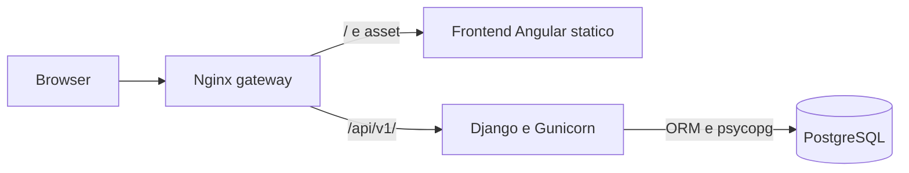

# Hotel Tempio V2 — Architettura proposta

Data: 19 ottobre 2026. Stato: progetto tecnico; le decisioni confermate in [DECISIONI.md](DECISIONI.md) prevalgono sulle proposte iniziali. I dettagli implementativi e i limiti effettivi sono documentati nel README di consegna.

## Vincoli ricevuti

Frontend Angular e TypeScript, Tailwind CSS; backend Python e Django; ORM Django su PostgreSQL; API REST implementate con classi DRF APIView; immagini Docker separate e comunicazione attraverso reti Docker; Nginx come reverse proxy.

## Topologia



Quattro servizi distinti in Docker Compose:

| Servizio | Immagine | Reti e responsabilità |
| --- | --- | --- |
| gateway | Nginx con configurazione dedicata | Unico servizio con porte pubblicate; inoltro frontend/API, limiti richiesta e TLS secondo hosting |
| frontend | Build Angular multistadio Node → server statico Nginx | Rete applicativa; fallback SPA e asset con nomi hash |
| backend | Python, Django e Gunicorn, utente senza privilegi | Rete applicativa e rete dati; API REST e regole di dominio |
| database | PostgreSQL | Solo rete dati privata internal, volume persistente e healthcheck |

Il browser chiama `/api/v1/` sullo stesso dominio: i nomi dei servizi Docker non compaiono nel codice client. Database e backend non hanno porte pubblicate in produzione. La rete dati è separata e interna; eventuali integrazioni esterne necessitano di uscita dalla rete applicativa. HTTPS dipende dalla destinazione di installazione da specificare.

Migrations e creazione asset backend sono passaggi espliciti di inizializzazione/rilascio, prima dell'avvio operativo. Le migrazioni non devono partire contemporaneamente in ogni worker. Dipendenze, immagini e versioni vengono bloccate nella consegna implementativa; `.env.example` documenta le variabili, le credenziali reali restano fuori dal repository. Dati dimostrativi solo tramite comando esplicito.

## Versioni e librerie

La scelta proposta privilegia release stabili e compatibili. Le patch effettive verranno risolte e bloccate al momento dell'implementazione, con build e test; queste indicazioni non equivalgono a un lockfile verificato.

- **Angular 22:** componenti standalone, TypeScript strict, routing lazy per funzionalità, stato locale con Signals, servizi HttpClient tipizzati e RxJS per flussi asincroni. Node LTS e TypeScript scelti nella matrice ufficiale di compatibilità.
- **Tailwind CSS 4:** integrazione PostCSS in build, tema e utility condivisi. Nessuna dipendenza dal CDN Tailwind dei prototipi nella versione operativa.
- **Componenti UI applicativi riutilizzabili**, con HTML semantico e form reattivi. Angular CDK e librerie scheduler non sono state necessarie per questa versione; il planning e una griglia applicativa senza licenze commerciali.
- **Django 5.2 LTS** come proposta per manutenzione, con ultima patch supportata e Python compatibile; **Django 6.1** è l'alternativa stabile più recente da valutare se si preferisce seguire gli aggiornamenti di funzionalità. DRF dichiara supporto per entrambe le serie.
- **Django REST Framework**, psycopg e Gunicorn. Il contratto REST corrente e documentato in API-CONTRACT.md, con modelli TypeScript espliciti; generazione automatica OpenAPI/client non inclusa nella prima consegna.
- **PostgreSQL:** major supportata da Django, con pin della versione di immagine durante l'implementazione. Stesso motore per test di integrazione e produzione.

Fonti ufficiali consultate:

- [Release Angular](https://angular.dev/reference/releases) e [compatibilità Angular/Node/TypeScript](https://angular.dev/reference/versions).
- [Tailwind con Angular](https://tailwindcss.com/docs/installation/framework-guides/angular).
- [Versioni Django supportate](https://www.djangoproject.com/download/) e [requisiti DRF](https://www.django-rest-framework.org/#requirements).
- [Classi APIView](https://www.django-rest-framework.org/api-guide/views/).

## Organizzazione del codice

```text
HOTEL-V2/
  frontend/
    src/app/
      core/                 # autenticazione, HTTP, errori, configurazione
      shared/               # editor risorse, pagamenti, tabelle, feedback
      layout/               # shell, sidebar, header, navigazione mobile
      features/
        auth/
        dashboard/
        planning/
        stays/
        groups/
        cash/
        inventory/
        reports/
        settings/           # camere, gruppi, listino, causali, utenti
  backend/
    config/                 # settings, URL, WSGI
    hotel/
      api/                  # APIView, URL, errori
      models.py             # entita e vincoli
      serializers.py        # contratti e validazione
      services.py           # comandi e transazioni
      selectors.py          # query e aggregazioni
      migrations/
      management/commands/
      tests/
  infrastructure/nginx/
  docs/
  compose.yaml
  .env.example
```

Albero corrispondente al nucleo implementato; file operativi e test browser si trovano anche in scripts/.

Frontend organizzato per funzionalità: pagine che coordinano dati e azioni, componenti di presentazione piccoli, servizi di accesso API e modelli di contratto. API e logica di pagamento non si distribuiscono nei template. Ogni funzionalità viene caricata quando serve. Moduli condivisi senza dipendenze circolari.

Backend con una app Django `hotel`, organizzata per responsabilita: `api/` per APIView e URL; `serializers.py` per contratti; `services.py` per comandi e transazioni; `selectors.py` per letture; `models.py` e migrazioni per persistenza. Nessun calcolo economico affidato al frontend. Incasso, allocazioni e movimento di cassa vengono creati insieme da un servizio esplicito.

## Modello di dominio iniziale

| Entità | Responsabilità |
| --- | --- |
| User | Account con email, ruolo e stato; autore autenticato delle operazioni |
| Room | Codice, piano, tipologia, capienza e stato operativo |
| Guest / StayGuest | Da dettagliare secondo i dati ospite richiesti |
| Group | Etichetta e colore; eventuale referente/debitore da confermare |
| Stay | Camera, date, ospiti/PAX, trattamento, stato, gruppo, note |
| PriceItem | Listino attivo e unità di misura |
| Charge | Addebito camera o extra con descrizione e prezzo storico, quantità, autore e timestamp |
| Payment | Incasso effettivo, metodo, causale, autore e data effettiva/registrazione |
| PaymentAllocation | Quota di pagamento assegnata a specifici addebiti, anche su più camere di un gruppo |
| CashReason / CashMovement | Causali e movimenti effettivi di entrata/uscita, legati agli incassi |
| Shift | Da definire come fascia o sessione contabile |
| StockItem / StockMovement | Unità base, soglia e movimenti di carico/scarico |
| AuditEvent | Traccia delle modifiche operative e amministrative rilevanti |

Prenotazioni, trasferimenti camera, rate giornaliere, intestazione del conto e dati di più strutture richiedono di confermare l'ambito prima di congelare lo schema. Lo stato fisico del soggiorno resta distinto dal saldo: una partenza con debito non deve occupare indefinitamente la camera.

## Coerenza dei dati

- Importi con Decimal nel backend e PostgreSQL; nei contratti JSON importi come stringhe decimali. Quantità di magazzino decimali quando necessario. Arrotondamenti espliciti e concordati.
- Prezzo e descrizione copiati sull'addebito al momento della registrazione: una modifica al listino non altera lo storico.
- Stati pagato/parziale/da pagare derivati da addebiti e allocazioni, con riepiloghi separati camera/extra. L'interfaccia non invia un semplice flag «pagato» come prova dell'incasso.
- Ogni pagamento genera il proprio movimento di cassa nella stessa transazione. I crediti aperti non aumentano gli incassi. Entrate e uscite manuali richiedono una causale con direzione coerente e restano distinguibili dagli incassi dei soggiorni.
- Incassi e rettifiche con autore derivato dalla sessione, timestamp server e audit. Retrodatazione e operatore attribuito solo se richiesti e con permessi espliciti.
- Idempotenza sui comandi di pagamento e chiusura, vincoli univoci e gestione dei retry per evitare doppi incassi. Blocco delle righe coinvolte nelle allocazioni concorrenti; ordine coerente dei lock sui gruppi.
- Sovrapposizioni camera impedite anche nel database tramite vincolo PostgreSQL adeguato. Intervalli inclusivi in ingresso ed esclusivi in uscita; day use e trasferimenti richiedono la conferma della granularità temporale.
- Storni e correzioni economiche tracciabili, con regole da concordare. Integrità referenziale a protezione di conti e storico; disattivazione delle anagrafiche usate.
- Timestamp memorizzati in UTC e visualizzati in Europe/Rome. Date soggiorno e giorno contabile trattati secondo le regole concordate, anche nei turni notturni.

Riferimenti: [transazioni Django](https://docs.djangoproject.com/en/5.2/topics/db/transactions/) e [vincoli PostgreSQL tramite Django](https://docs.djangoproject.com/en/5.2/ref/contrib/postgres/constraints/).

## Contratti REST proposti

Tutti gli endpoint applicativi mediante classi `APIView`, con serializer, autenticazione, permessi e URL espliciti. Non si sostituisce il requisito con ModelViewSet.

| Risorsa | Esempi di endpoint |
| --- | --- |
| Sessione | `/api/v1/auth/csrf/`, `/login/`, `/logout/`, `/me/` |
| Camere e planning | `/api/v1/rooms/`, `/api/v1/planning/?start=...&end=...` |
| Soggiorni | `/api/v1/stays/`, `/stays/{id}/`, `/stays/{id}/check-out/` |
| Addebiti e incassi | `/api/v1/stays/{id}/charges/`, `/api/v1/payments/` |
| Gruppi | `/api/v1/groups/`, `/groups/{id}/statement/` |
| Cassa | `/api/v1/cash/movements/`, `/api/v1/cash/reasons/` |
| Listino | `/api/v1/extra-categories/`, `/extra-categories/{id}/`, `/api/v1/price-items/`, `/price-items/{id}/` |
| Magazzino | `/api/v1/inventory/items/`, `/inventory/movements/` |
| Report | `/api/v1/reports/occupancy/`, `/cash/`, `/operators/` |
| Amministrazione | `/api/v1/users/`, `/api/v1/settings/` |

Metodi HTTP e serializer distinti per lettura/scrittura; liste paginate e filtri validati; errori con codice, messaggio e dettagli dei campi. Il documento API-CONTRACT.md descrive conti parziali e gruppi. Autenticazione verificata nel backend per ogni azione; tutti gli operatori hanno pieno controllo applicativo come richiesto, con guard Angular per la navigazione.

## Accesso e frontend

Per un gestionale web sullo stesso dominio si propone autenticazione Django con cookie di sessione HttpOnly, SameSite e Secure in HTTPS, più protezione CSRF anche sul login. Integrazione XSRF Angular/Django configurata esplicitamente e testata. JWT/SSO richiedono una motivazione legata a client esterni o integrazioni, da chiarire.

Caricamento differito delle funzionalità, rendering prevedibile, tracking stabile delle righe e richieste cancellabili. Planning interrogato per intervallo visibile con limite massimo; ricalcoli e aggregazioni efficienti; nessuna query API per ciascuna cella. Cache limitata alle anagrafiche appropriate, invalidata dopo modifiche. Stato di caricamento, errore, vuoto e aggiornamento concorrente gestito visibilmente.

Tailwind centralizza colori e spaziature; componenti di form con label, errori e focus; modali accessibili da tastiera; icone accompagnate da testo; colori del gruppo non usati come unico indicatore. Build con budget del bundle e asset compressi/cacheabili al proxy. Eventuale aggiornamento in tempo reale dipende dai requisiti di uso simultaneo.

## Convenzioni e verifica

Convenzioni proposte: [style guide Angular](https://angular.dev/style-guide), TypeScript strict senza `any` ingiustificati, ESLint e formattazione coerente; Python con PEP 8, Ruff, type hint sui servizi e configurazione ambienti separata. Dipendenze aggiunte solo per esigenze concrete e con licenze concordate.

Test prioritari su PostgreSQL reale: sovrapposizioni concorrenti, calcolo conto, prezzi storici, acconti, allocazioni di gruppo, doppi invii, check-out con credito se previsto, permessi e magazzino concorrente. Test frontend mirati ai flussi e ai componenti con comportamento significativo. End-to-end: login → check-in → extra → pagamento parziale → check-out → verifica cassa/report.

Consegna operativa verificata con build Angular, migrazioni, check Django, test automatici, `docker compose config`, build/avvio dei servizi, verifica instradamento Nginx e salute del database. Backup consistente e prova di ripristino separata. Obiettivi di prestazioni, conservazione dati e disponibilità vengono fissati con il contesto di installazione.

La topologia delle reti segue [la documentazione ufficiale Docker Compose](https://docs.docker.com/compose/how-tos/networking/). Questo documento descrive l'implementazione prevista e non attesta l'esecuzione di tali verifiche.
